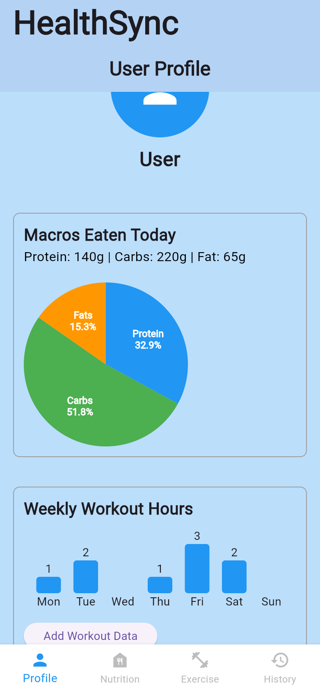
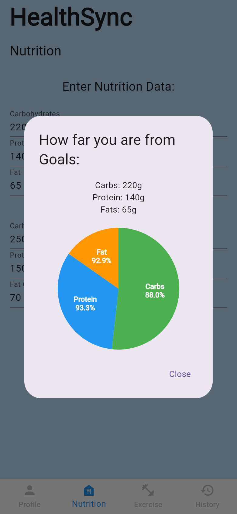
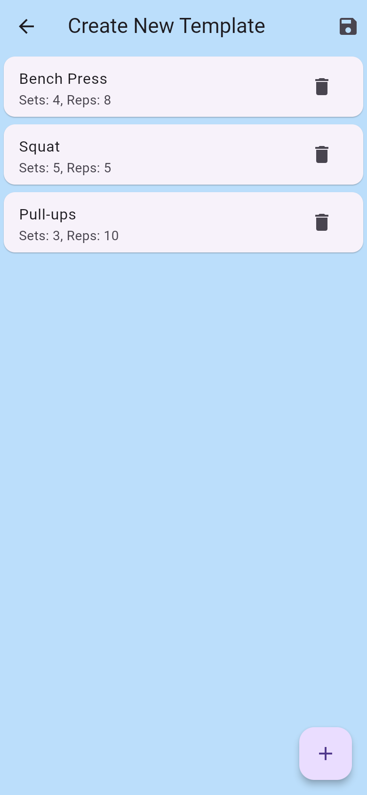
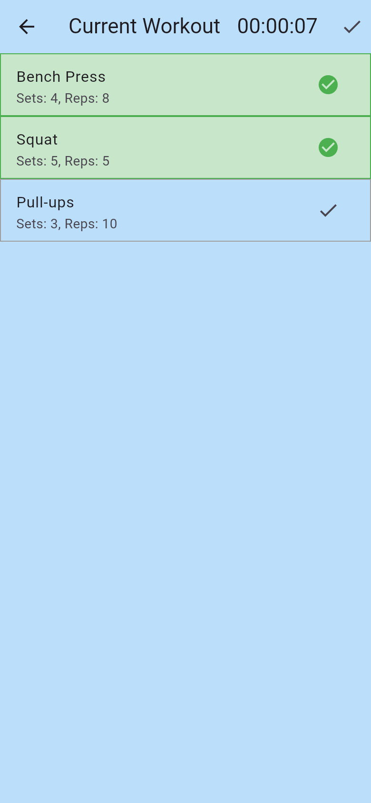
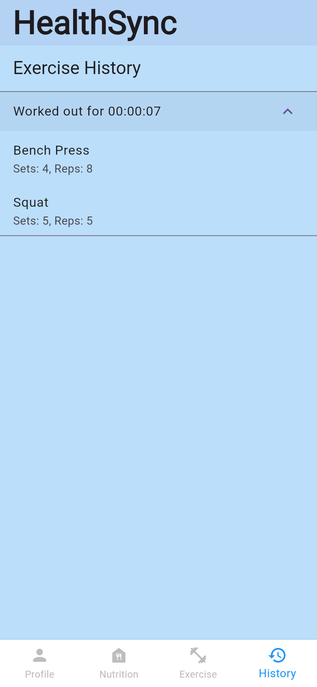

# HealthSync

[](https://github.com/rextail90/HealthSync_V2/actions/workflows/ci.yml)

A cross-platform fitness tracker built with Flutter and Firebase. You can log workouts in real time, save reusable workout templates, track daily macros against your goals, and look back through past sessions.

**Try it in your browser:** https://rextail90.github.io/HealthSync_V2/ (tap **Skip** to look around without an account)

Built by a team of students in May 2024. See the [contributors page](https://github.com/rextail90/HealthSync_V2/graphs/contributors) for who worked on it.

## Screenshots

| Profile | Nutrition goals | Template builder | Live workout | History |
|:---:|:---:|:---:|:---:|:---:|
|  |  |  |  |  |

## Features

- **Accounts.** Email/password sign-up and login through Firebase Authentication. There is also a guest "Skip" mode.
- **Quick workouts.** Start a timer, add exercises as you go, and check them off as you finish them.
- **Workout templates.** Build a routine once (exercise, sets, reps) and start it with one tap.
- **Workout timer that keeps going.** Leave the workout screen, lock your phone or switch browser tabs and the time stays accurate. A bar on the Exercise tab takes you back to the workout.
- **Workout history.** Every finished session is saved with its date, duration and completed exercises.
- **Nutrition tracking.** Enter protein, carbs and fat with daily goals and see a pie chart of how close you are to each goal. Macros reset each new day.
- **Profile dashboard.** Today's macro breakdown as a pie chart (drawn with `CustomPainter`) and a weekly workout-hours bar chart.
- **Saved on your device.** Templates, history, macros and weekly hours are still there after you close the app.

## Tech stack

| Layer | Choice |
|---|---|
| UI | Flutter (Material 3), Dart 3 |
| State | [`provider`](https://pub.dev/packages/provider) (`ChangeNotifier`) |
| Storage | [`shared_preferences`](https://pub.dev/packages/shared_preferences) (JSON, on-device / browser storage) |
| Auth | Firebase Authentication |
| Charts | Built by hand (`CustomPainter` pie chart, widget-based bar chart), no chart library |
| CI/CD | GitHub Actions: analyze, test, build and deploy to GitHub Pages |
| Platforms | Android, iOS, web, macOS, Windows |

## Project structure

```
lib/
├── main.dart                  # App entry, providers, login screen, tab shell
├── firebase_options.dart      # Generated by `flutterfire configure` (gitignored)
├── providers/                 # App state (ChangeNotifier classes)
│   ├── timer_provider.dart          # Workout timer shared across screens
│   ├── quick_workout_provider.dart  # Exercises queued in a quick workout
│   ├── workout_template_provider.dart
│   ├── history_provider.dart        # Completed sessions
│   ├── nutrition_data_provider.dart # Today's macros
│   └── storage.dart                 # JSON read/write helpers for saved data
├── screens/                   # One file per screen/tab
└── widgets/                   # Shared UI: pie chart, add-exercise dialog, timer text
test/                          # Unit and widget tests
```

### How state flows

All app state lives in `ChangeNotifier` providers registered once in `main.dart`. Screens read state with `context.watch` or `context.select` and change it with `context.read`. The bottom tabs sit in an `IndexedStack`, so switching tabs keeps form input and charts in place. For example, entering macros on the Nutrition tab updates the Profile pie chart right away.

Providers save their data as JSON through `shared_preferences` whenever it changes and load it on startup. If saved data is ever corrupt, the app starts empty instead of crashing.

The workout timer stores the time the workout started and works out the elapsed time from the clock. Its one-second tick only redraws the small `TimerText` widget, not the screens around it.

## Getting started

**Prerequisites:** [Flutter SDK](https://docs.flutter.dev/get-started/install) (current stable, 3.47 or newer), a device or emulator, and a [Firebase](https://console.firebase.google.com/) project with Email/Password sign-in enabled.

Firebase config files are not committed, so you generate your own:

```bash
git clone https://github.com/rextail90/HealthSync_V2.git
cd HealthSync_V2
flutter pub get
dart pub global activate flutterfire_cli
flutterfire configure   # creates lib/firebase_options.dart and platform config files
flutter run -d chrome   # or pick a phone/emulator with `flutter devices`
```

## Testing

```bash
flutter analyze
flutter test
```

The tests cover the timer (including time passing while no ticks fire), saving and reloading data, macros resetting on a new day, recovery from corrupt saved data, input validation on the nutrition form, and the pie chart's empty state.

## Deployment

Every push to `main` runs [`.github/workflows/ci.yml`](.github/workflows/ci.yml). It analyzes, tests and builds the web app, then publishes it to GitHub Pages. Pull requests get the same checks without deploying.

One-time setup for a fork or a new repo:

1. **Settings → Secrets and variables → Actions → New repository secret.** Name it `FIREBASE_OPTIONS_DART` and paste the full contents of your `lib/firebase_options.dart`.
2. **Settings → Pages → Build and deployment → Source:** choose **GitHub Actions**.

The deployed site is a public web app, so its Firebase web API key is visible in the browser, as with any Firebase web app. Protect the project by restricting that key to your domains in Google Cloud Console.

## Limitations and next steps

- Data is saved on each device and doesn't sync between devices. The next step is to store it per user in Cloud Firestore.
- Weekly workout hours are entered by hand. They could be calculated from workout history instead.
- Guest mode skips authentication completely.
